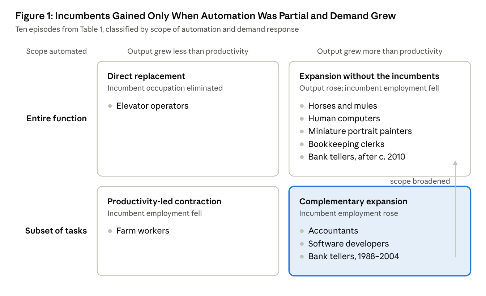

Since late 2022, large language models and related artificial intelligence (AI) systems have sharply reduced the cost of performing many cognitive tasks. In the business market for model inference, prices fell by roughly three orders of magnitude in about two years (Demirer, Fradkin, and Tadelis 2026). Whether this will reduce employment in the occupations that perform those tasks is among the most consequential open questions in economics, and public debate has framed it as a contest of narratives. On one account, cheaper intelligence will be used far more, as cheaper calculation was after the electronic spreadsheet, and demand for the workers who produce cognitive services will expand with it. On the other, this technology differs from its predecessors because it can perform whole jobs, so expanded demand will be met with more machine services rather than more workers. Geoffrey Hinton, who has made the second argument publicly (Hinton 2025b; Ma 2025), put it to me in six words: "The new hires will be AI" (personal communication, 2026).

The question is old, and so is the apparatus for answering it. Ricardo added a chapter "On Machinery" to the third edition of his *Principles* in 1821 to concede that mechanization could harm workers (Hollander 2019), and each later wave of automation has revived the concern (Mokyr, Vickers, and Ziebarth 2015). For a single market, the theory of derived demand gives a precise answer: when the price of an input that can replace labor falls, employment rises if and only if the price elasticity of product demand, $ε$, exceeds the elasticity of substitution between that input and labor, $σ$. This is the inequality that Hicks (1932) showed governs Marshall's (1890) third law of derived demand, and it is a textbook result in the theory of labor demand (Hamermesh 1993). The two narratives about AI are therefore claims about two elasticities—and, over longer horizons, about whether new tasks for people appear as fast as AI takes over existing ones. Stated that way, the dispute becomes partly testable, and the evidence can be sorted by what it does and does not identify.

Applied to AI, the condition yields three conclusions that run against common readings of the evidence. First, the rapid growth in the use of AI as its price has fallen—often described as a Jevons paradox, after Jevons's (1865) observation that more efficient steam engines raised Britain's consumption of coal—is not evidence that AI will create jobs. Total use of an input rises with its efficiency if and only if it substitutes readily for the inputs it works with; while AI's cost share is small and labor is the main other input, that means roughly $σ$ > 1. To the extent that the boom in AI use reflects falling prices, it therefore raises the bar for the optimistic view: employment grows only if demand for the product is more elastic still. The familiar argument that elastic demand turns productivity gains into jobs is valid for AI that makes workers more productive, not for AI that replaces them.

Second, the near-zero aggregate employment effects reported since 2022 are what the theory predicts whichever view is right. In the framework, the employment effect of cheaper AI services is scaled by AI's share of production costs, and the effect of AI copilots by the productivity gains they deliver. By both measures, AI's role in production remains small: by the second quarter of 2026, generative AI was saving about 2 percent of all US work hours (Federal Reserve Bank of St. Louis 2026). The null results rule out rapid disruption, but they carry little information about the sign of $ε$ − $σ$. That AI's role is still so small after a thousandfold fall in list prices is itself informative: unless AI substitutes only weakly for labor, the effective price of AI services—the cost per task completed, including the cost of integrating AI into production and checking its work—has probably fallen far less than the price of inference.

Third, the framework offers a resolution of a puzzle in the evidence. Field experiments find that less experienced or less skilled workers gain the most from AI assistance, yet US payroll data show the clearest declines in the employment of young workers in exposed occupations, mostly through reduced hiring. The experiments measure AI as a copilot that raises the productivity of people already employed; hiring responds to AI as an agent that performs tasks at a falling price. The two channels are governed by different conditions, and the capability that helps a novice most—access to codified expertise—can also be the capability that lets a firm do without one.

The article builds on earlier contributions to the *Journal of Economic Perspectives*. Autor (2015) argued that automation's effect on the demand for workers depends on how strongly automated and human tasks complement each other, on the elasticity of labor supply, and on the price and income elasticities of demand for the output. Acemoglu and Restrepo (2019) decomposed technology's effects on labor demand into displacement, productivity, and reinstatement effects, and found that since the late 1980s displacement has accelerated while reinstatement has slowed. Agrawal, Gans, and Goldfarb (2019) showed that the labor-market effect of AI that automates prediction is ambiguous, because cheaper prediction substitutes for workers in prediction tasks but complements human judgment and can make it profitable to automate whole decisions. In the journal's recent symposium on artificial intelligence, Jones (2026) argued that weak links among complementary tasks will slow AI's effect on output, and Demirer, Fradkin, and Tadelis (2026) described the market in which firms buy AI; Jones treats labor markets only briefly, and Demirer, Fradkin, and Tadelis leave them outside their scope. Beyond the three conclusions above, this article extends the condition to allow new tasks—a second route to employment growth even when $σ$ > $ε$—classifies twelve historical episodes of automation by the scope of the automated tasks and the response of demand, shows how $ε$ and $σ$ for AI can be measured with data that exist or could be collected, and states predictions with numerical thresholds, fixed before the data exist, in the spirit of the pre-analysis plans discussed in the same journal (Olken 2015; Coffman and Niederle 2015).

The evidence through mid-2026 supports a guarded reading. Demand for cognitive services is plausibly elastic where current prices exclude much of the potential demand, as in civil legal services for low-income households, but there is no evidence that it is elastic across cognitive work generally, and the historical record suggests that demand elasticities fall as markets mature (Bessen 2019). In the episodes examined here, automation raised incumbent employment when it automated part of a job in a market with expanding demand, and lowered it when it replaced the whole job, whatever happened to demand. The decisive questions—whether $σ$ rises past $ε$ as AI capabilities broaden, and whether new tasks for people appear faster than AI absorbs them—cannot yet be answered with economic data, but the indicators that should reveal the direction of change within about two years can be specified now.

## Derived Demand: An Old Answer to a New Question

### The Condition

Consider a competitive industry that produces output with constant returns to scale from two inputs: labor and AI services, meaning model inference, compute, and software agents purchased as inputs. Each input has a productivity term that converts physical units into effective units, $a_{L}$ for labor and $a_{M}$ for AI services. The industry takes the wage, w, and the price of AI services, $p_{M}$, as given and prices output at unit cost, so cost reductions pass through fully to the output price. Product demand has a constant price elasticity, $ε$, measured as a positive number. Let $s_{M}$ denote AI's share of production cost and $σ$ the elasticity of substitution between effective labor and effective AI services. The percentage change in employment, L, in response to a 1 percent change in the effective price of AI services, $p_{M}$/$a_{M}$, is

$$
\frac{\partial \ln L}{\partial \ln (p_M / a_M)} = s_M\,(\sigma - \varepsilon).
$$

When AI services become cheaper, firms substitute them for labor at a rate governed by $σ$. The cost saving also lowers the output price, which raises the quantity demanded at a rate governed by $ε$. Employment rises if and only if the second effect is larger, that is, if $ε$ > $σ$. Both effects are scaled by AI's cost share, so while AI accounts for a small share of costs, a modest fall in its price has a small effect on employment in either direction. The result is standard (Hamermesh 1986, 1993). For the large price declines of recent years, its counterpart is that the cumulative change in employment is of the order of the change in AI's cost share unless $σ$ is close to one or $ε$ differs from $σ$ by much more than $σ$ differs from one; online Appendix A derives both results in this notation.

### Copilots and Agents

AI can also enter production as a tool that raises the productivity of the workers who use it, $a_{L}$, without being a separately priced input. In the same setting, the employment response to such labor-augmenting technical change is

$$
\frac{\partial \ln L}{\partial \ln a_L} = s_L\,(\varepsilon - 1) + s_M\,(\sigma - 1),
$$

where $s_{L}$ = 1 − $s_{M}$ is labor's cost share. When AI is not a separate input ($s_{M}$ = 0), the expression reduces to $ε$ − 1: higher productivity raises employment if and only if product demand is elastic. This is the logic behind most public claims that cheaper AI will create jobs.

I refer to the two ways AI enters production as the copilot channel and the agent channel. A copilot makes the worker who uses it more productive; an agent performs a task itself, at a price. The demand-expansion view assumes, usually implicitly, that AI operates mainly as a copilot, or as an agent with $ε$ > $σ$. The substitution view holds that AI increasingly operates as an agent with $σ$ > $ε$, and that $σ$ rises as AI performs a growing share of each occupation's tasks. Once AI is a separately priced input, elastic demand is neither necessary nor sufficient for employment to rise. It is not sufficient because $σ$ may exceed $ε$, and it is not necessary because $ε$ > $σ$ can hold with $ε$ < 1 when AI and labor are poor substitutes.

The agent channel has a limiting case. If AI services and labor are perfect substitutes in a task, firms use labor in that task only when its effective cost is no higher than that of AI, so the wage for the task cannot exceed ($a_{L}$/$a_{M}$)·$p_{M}$. At this corner the local formulas do not apply; instead, the cost of AI caps what labor can earn in the task, and the cap falls with the price of AI. Restrepo (2025) obtains the economy-wide counterpart: once compute can perform all the work that is essential for growth, wages converge to the cost of the compute needed to reproduce human work.

### When the List of Tasks Changes

The condition takes the set of tasks as given, but technology also changes which tasks exist and who performs them. This opens a second route by which employment can rise or fall. Write the constant-elasticity technology in the form used by Acemoglu and Restrepo (2019), and let $Γ$ be labor's weight in production—what they call the task content of production for labor. Holding the wage and labor productivity fixed, employment then changes by

$$
\Delta \ln L \;=\; \underbrace{(\sigma - \varepsilon)\,\Delta \ln p}_{\text{existing tasks}} \;+\; \underbrace{\Delta \ln \Gamma}_{\text{task content}},
$$

where $Δ$ln p is the change in unit cost from any source (online Appendix A). The first term is the condition above: the race between substitution and demand expansion within a given set of tasks. The second records changes in the tasks assigned to labor. It falls when AI takes over tasks that people performed, which Acemoglu and Restrepo call displacement, and it rises when new tasks appear in which people have the advantage, which they call reinstatement. $Γ$ is not a third elasticity; it summarizes how innovation changes the structure of production.

The extension makes three points precise. First, employment can rise even when $σ$ > $ε$, if new tasks for people raise $Γ$ fast enough, and it can fall despite elastic demand if AI takes over tasks faster than new ones appear. Second, new products are not the same as new tasks. A new product made with existing tasks raises the demand for those tasks, an effect that runs through $ε$; only new tasks in which people have a role raise $Γ$. Third, the substitution view challenges both routes. "The new hires will be AI" asserts both that AI will meet expanded demand, a high $σ$, and that AI will perform the new tasks as well, so that reinstatement stays small. The second claim is what would set AI apart from earlier technologies, which created work they could not do themselves: photography needed photographers, and computers needed programmers.

### What a Boom in AI Use Reveals

The growth in AI use as prices have fallen is often cited as evidence for the demand-expansion view, by analogy with Jevons's observation about coal. The share of employed US adults who used generative AI for work in the previous week rose from 28 percent in the third quarter of 2024 to 39 percent in the second quarter of 2026 (Federal Reserve Bank of St. Louis 2026). The framework shows that a Jevons effect in AI use speaks to $σ$, not to $ε$. The own-price elasticity of demand for AI services is −($s_{L}$·$σ$ + $s_{M}$·$ε$), and total use of AI services rises with their efficiency, $a_{M}$—equivalently, spending on them rises as their price falls—if and only if $s_{L}$·$σ$ + $s_{M}$·$ε$ > 1 (online Appendix A). With AI's cost share small, this requires approximately $σ$ > 1. When AI works with several other inputs, the condition concerns its substitutability for all of them together, which can reflect substitution for software or purchased services as well as for labor. And adoption shares like those above rise with any downward-sloping demand; the informative statistic is spending on AI services as their effective price falls.

Spending on AI services that rises as their effective price falls would therefore be evidence that AI substitutes readily for labor. It would not settle the employment question, because employment can still rise if $ε$ > $σ$, but it would raise the bar: with $σ$ > 1, that requires $ε$ > 1 as well. Jevons's paradox concerned an input whose efficiency rose. Its analogue for workers is the copilot channel, where the condition for employment to rise is $ε$ > 1, so the analogy supports the demand-expansion view only to the extent that AI raises the productivity of workers rather than performing their tasks. Growth in AI use also reflects diffusion and an expanding set of tasks that AI can perform at all, and both weaken the inference from use to $σ$: diffusion is not a response to price, and an expanding set of tasks that AI performs is a fall in $Γ$ rather than a movement along the demand curve for AI services. Growth of the second kind is nonetheless evidence of displacement, because in task-based models the movement of tasks from labor to capital is the main channel through which automation displaces workers (Acemoglu and Restrepo 2018).

### What the Condition Leaves Out

The formula describes one market in partial equilibrium, and four qualifications matter for interpreting the evidence.

First, the two elasticities must refer to the same market. A single firm's demand elasticity includes business taken from rivals and so exceeds the market elasticity. French firms that adopted robots expanded employment while employment in their industries fell (Acemoglu, Lelarge, and Restrepo 2020; see also Koch, Manuylov, and Smolka 2021), so evidence that AI-adopting firms are hiring is weak evidence that $ε$ > $σ$ for their industries.

Second, $σ$ must be interpreted with care. In task-based models where each task is performed by either capital or labor, the elasticity of substitution between the two at a given assignment of tasks equals the elasticity of substitution across tasks—the parameter that Jones (2026) argues is below one. Displacement in those models comes instead from the extensive margin, as capital takes over tasks that labor used to perform (Acemoglu and Restrepo 2018, 2019). In the reduced form used here, two cases differ. When cheaper AI takes over more of the tasks it can already perform, the effective $σ$ exceeds the cross-task elasticity. When the frontier of capabilities advances, the reduced form registers a fall in labor's task content, $Γ$. The constant-$σ$ formula is best read as describing the response of employment to cheaper AI at a given frontier; how the frontier moves is taken up later.

Third, aggregate effects differ from industry effects. With a fixed labor supply and flexible wages, a fall in labor demand in one industry shows up mainly as lower relative wages and the reallocation of workers. Caselli and Manning (2019) show that under constant returns, perfect competition, and a constant interest rate, a new technology cannot reduce the average real wage in the long run unless it raises the price of investment goods relative to consumption goods, although particular groups of workers, even a majority, can lose. Industries with faster productivity growth have lost employment, but the losses have been offset by gains in customer industries and through higher final demand (Autor and Salomons 2018), and product-demand spillovers turned routine-replacing technical change in Europe into net job growth (Gregory, Salomons, and Zierahn 2022). Aggregate employment is therefore a weak test of either view; occupational employment, hiring, relative wages, and labor's share are more informative.

Finally, labor here is a single input. When automation removes an occupation's less expert tasks, wages in it rise and employment falls, whereas automation of its expert tasks lowers wages and raises employment (Autor and Thompson 2025), so employment counts alone can misstate the effect on workers. Equipment has been more substitutable for less skilled than for more skilled labor (Krusell, Ohanian, Ríos-Rull, and Violante 2000), and $σ$ for AI may likewise differ by experience—a possibility to which the evidence below returns.

## Lessons from Past Automation

Before turning to AI, it is worth asking what the condition explains about earlier automation. Table 1 classifies twelve technology–occupation episodes on two observable dimensions. The first is whether the technology performed a subset of the incumbent occupation's tasks or its entire function, an indicator of whether $σ$ was low or high. The second is whether output of the affected good or service grew faster than the productivity gain the technology delivered, an ex post indicator of elastic demand. Because this indicator is defined by total input, it is not independent of the employment outcome under partial automation, so the first regularity below is better read as a description than as a test. Elasticities were not estimated for most episodes, so the classification is qualitative; online Appendix B sets out the coding rules. The episodes were chosen for their prominence in debates about automation rather than sampled, so they illustrate mechanisms and do not measure how often each outcome occurs. The approach follows Atack, Margo, and Rhode (2019) in examining automation task by task. Figure 1 places ten of the episodes on the two dimensions.

**Table 1**

**Twelve Episodes of Automation**

| Technology (period) | Incumbent occupation | Scope automated | Demand for output | Incumbent employment | Source |
| -------------- | ------------ | ------------ | ------------ | -------------- | ------------ |
| Electronic spreadsheet (1980s–) | Accountants | Calculation, a subset of tasks | Expanded | Rose | Goldstein (2015) |
| Electronic spreadsheet (1980s–) | Bookkeeping and accounting clerks | Core function | Expanded | Fell | Goldstein (2015) |
| Automated teller machine (1988–2004) | Bank tellers | Cash handling, a subset of tasks | Expanded: urban branches rose 43 percent | Rose modestly nationally; tellers per urban branch fell from 20 to 13 | Bessen (2015b); Autor (2015) |
| Online and mobile banking (c. 2010–) | Bank tellers | Most routine transactions | Transactions moved to digital channels | Falling; projected −13 percent over 2025–2035 | BLS (2026d) |
| High-level languages, compilers, libraries (1957–) | Programmers and software developers | Writing code, a subset of tasks | Expanded | IT occupations rose tenfold, 1970–2014 | Beckhusen (2016); online Appendix B |
| Deep-learning image analysis (2016–) | Radiologists | Image interpretation, a subset of tasks | Imaging volumes rising | Mayo Clinic radiologists up 55 percent since 2016, to more than 400 | Lohr (2025) |
| Electronic computers (1940s–1960s) | Human computers | Entire function (calculation) | Expanded | Occupation disappeared | Grier (2005) |
| Internal combustion engine (1900–1960) | Horses and mules | Entire function (traction) | Expanded | More than 21 million (1900) to about 3 million (1960) | Brynjolfsson and McAfee (2015) |
| Photography (1840s–1860s) | Miniature portrait painters | Entire function (recording a likeness) | Expanded | Many miniaturists abandoned the art after 1839 | Barratt (2004); online Appendix B |
| Tractors and mechanization (1900–2000) | Farm workers | Power and harvesting, a subset of tasks | Grew less than productivity | From 41 to 2 percent of US employment | Autor (2015) |
| Automatic elevators (mid-twentieth century) | Elevator operators | Entire function | No induced demand | Occupation eliminated | Bessen (2016) |
| Automatic telephone switching (1920–1940) | Telephone operators | Entire function (connecting calls) | Not assessed | Incumbents displaced; later cohorts employed elsewhere | Feigenbaum and Gross (2024) |

*Source:* Author's classification, based on the sources listed. *Note:* "Expanded" means that output of the good or service grew faster than the productivity gain the technology delivered.

{width=100%}

*Source:* Author's classification of the episodes in Table 1. *Note:* Radiology is not placed because its employment trend cannot yet be attributed to AI; telephone switching is not placed because the demand response was not assessed.

### Four Regularities

Subject to these caveats, four regularities emerge. The first is that partial automation in a growing market raised incumbent employment. This holds for accountants, for bank tellers during the spread of automated teller machines (ATMs), and for software developers. Bessen (2015a, 2015b) documents the mechanism for tellers: between 1988 and 2004, ATMs cut the number of tellers per urban bank branch from about 20 to 13, lowering the cost of operating a branch, and banks increased the number of urban branches by 43 percent, offsetting most but not all of the decline in tellers per branch. Nationally, teller employment rose modestly, from about 500,000 in 1980 to about 550,000 in 2010 (Autor 2015).

The second is that whole-function substitution reduced incumbent employment regardless of demand. This holds for horses, human computers, miniature painters, bookkeeping clerks, and elevator operators. The US horse and mule population grew sixfold between 1840 and 1900, to more than 21 million, and fell to about 3 million by 1960, although demand for transport rose throughout (Brynjolfsson and McAfee 2015); Leontief (1983) drew the analogy to human labor explicitly. In the language of the framework, these are cases in which $σ$ was effectively infinite: demand for the output grew, and the growth was met entirely by the new input.

The third is that the elimination of whole occupations by automation has been rare. Of about 270 detailed occupations in the 1950 Census, Bessen (2016) finds only one, elevator operator, that was eliminated primarily by automation by 2010. Narrower job titles, such as the human computers in Table 1, did disappear, but census occupations bundle tasks that were automated at different times, and the bundles have usually survived.

The fourth, and the most relevant to AI, is that occupations migrate between cells as a technology's scope broadens. Teller employment held up during the spread of ATMs but has fallen since about 2010, as online and mobile banking took over routine transactions, and the Bureau of Labor Statistics projects a further 13 percent decline between 2025 and 2035 (BLS 2026d). A general-purpose technology that improves every year can move an occupation from partial to whole-function substitution after a period of complementarity. At the level of the whole economy, the creation of new work has repeatedly offset displacement, but Acemoglu and Restrepo (2019) find that the balance has shifted: in their decomposition, the displacement effect reduced the task content of production for labor by about 0.48 percent a year in 1947–1987 and 0.70 percent a year in 1987–2017, while the reinstatement effect raised it by about 0.47 and 0.35 percent a year.

### Barely Cheaper Machines

The framework also explains why a technology's early years can be its worst for workers. Acemoglu and Restrepo (2019) call technologies that displace workers while raising productivity only a little "so-so technologies," with automated customer service among their examples; such technologies reduce labor demand because the productivity effect is too small to offset displacement. So-so automation is concentrated where machines first become competitive. When AI and labor are close substitutes in a task, the task moves to AI once AI's cost of performing it falls below labor's, that is, once $p_{M}$/$a_{M}$ < w/$a_{L}$. At that crossing point, displacement in the task is complete, but the cost saving—and with it the price reduction that drives demand expansion through $ε$—is close to zero. Each task that AI takes over at the margin of profitability therefore displaces labor with little offsetting expansion of demand; the offset grows only as AI's cost falls well below labor's in the tasks it has taken over. A technology that performs tasks at roughly the cost of labor is thus likely to look like so-so automation at first, even if its long-run productivity effects are large.

### Radiology

Radiology is a test case chosen by a proponent of the substitution view. In October 2016, Hinton said that "people should stop training radiologists now," because within about five years deep learning would outperform them (Hinton 2016). Nine years later, the radiology staff of the Mayo Clinic had grown 55 percent, to more than 400 radiologists (Lohr 2025), and average US radiologist compensation reached \$571,000 in 2025 (Medscape 2026). Hinton has since said that he spoke too broadly, that he meant image analysis specifically, and that he was wrong about timing but not about direction (Lohr 2025). Radiologists also consult, monitor patients, and perform procedures, so image interpretation is only part of the job—partial automation in the sense of Table 1. The case shows that the 2016 prediction was wrong about timing and about the scope of the job, but it does not identify a positive effect of AI on radiologists' employment. Imaging volumes were rising before deep learning was deployed, the supply of radiologists is constrained by residency positions and reimbursement rules, and radiologists given AI predictions in an experiment did not use them well (Agarwal, Moehring, Rajpurkar, and Salz 2023). For these reasons radiology is not placed in Figure 1.

## What Is Known about the Two Elasticities

No study has estimated either elasticity for generative AI. The available evidence is indirect, but it says a good deal about where each is likely to be high.

### Demand for Cognitive Services

Demand that current prices exclude is the strongest case for a high $ε$. Low-income Americans received no legal help, or not enough help, for 92 percent of the civil legal problems that substantially affected their lives in the previous year (Legal Services Corporation 2022). Gaps of this kind indicate a large mass of potential demand at prices below current ones. They are consistent with a high $ε$ over the relevant range of prices, but they are not elasticity estimates, because they do not measure willingness to pay at the prices AI would make feasible.

Satiation is the main argument on the other side. Bessen (2019) shows that in US textiles, steel, and motor vehicles, employment grew for decades alongside rapid productivity growth and then declined: demand was highly elastic when consumption was low and became inelastic as consumption approached satiation. Models of structural change formalize the same mechanism across sectors, through relative prices and through income effects on demand (Ngai and Pissarides 2007; Comin, Lashkari, and Mestieri 2021), and Autor (2015) emphasizes that the income elasticity of demand matters alongside the price elasticity. For AI, these results imply that $ε$ may be high for cognitive services precisely because consumption of many of them is far below satiation, and that $ε$ should be expected to fall as consumption rises.

Health care shows how far apart the two kinds of evidence can be. Hinton has argued that demand for health care is close to unlimited: "if you could make doctors five times as efficient, we could all have five times as much healthcare" (Hinton 2025b). Measured price elasticities point the other way. In the RAND Health Insurance Experiment, the elasticity of medical spending with respect to patients' out-of-pocket price was approximately −0.2 (Manning et al. 1987). That estimate is not the market elasticity relevant here, because insurance mutes the pass-through of costs to patients, and it does not capture rationing through waiting times and scarce providers, which cheaper provision could relieve. The case for elastic demand in health care rests on the removal of non-price rationing, not on measured price elasticities. Hinton himself argues that most occupations lack this property—"most jobs, I think, are not like that"—and expects a person working with an AI assistant to do work that once took ten people, with paralegals and call-center workers displaced early (Hinton 2025b).

The evidence is thus consistent with $ε$ > 1 in markets where current prices or non-price rationing exclude much of the potential demand, although no study measures it there. It does not support a general presumption of elastic demand for cognitive work, and the historical record implies that elasticities fall as markets mature. Even where $ε$ > 1, employment rises only if $ε$ also exceeds $σ$.

### Substitutability of AI for Labor

The literature on the elasticity of substitution between capital and labor provides a benchmark, and it is contested. Karabarbounis and Neiman (2014) estimate an elasticity of about 1.25 and attribute roughly half of the global decline in the labor share to the falling relative price of investment goods. Microeconomic estimates are lower: Oberfield and Raval (2021) estimate 0.5 to 0.7 for US manufacturing, and a meta-analysis of more than 3,000 estimates finds that correcting for publication bias and method choices lowers the mean from about 0.9 to about 0.3 (Gechert, Havranek, Irsova, and Kolcunova 2022).

These estimates concern equipment and structures, which perform few tasks from start to finish, and there is a specific reason to expect AI to be more substitutable. Earlier computerization was confined to tasks whose rules could be written down. It struggled with tasks that people perform without being able to say how—Polanyi's (1966) observation that "we can know more than we can tell." Autor (2015) discussed this constraint, which he called Polanyi's paradox, as a central limit on the substitution of computers for workers, and noted that machine learning, which infers rules from examples, potentially circumvents it, although he doubted that it would do so soon. Generative AI has done so for a wide range of language and image tasks, so the constraint that kept $σ$ low for earlier information technology binds less for AI.

Task-level evidence suggests that $σ$ varies widely across tasks and depends on complementary investment. Eloundou, Manning, Mishkin, and Rock (2024) estimate that roughly 1.8 percent of US jobs could have over half their tasks affected by large language models with simple interfaces, and just over 46 percent once software built to complement the models is taken into account; the gap between the two figures indicates how much of AI's potential reach depends on complementary investment. In a field experiment with 758 consultants, access to GPT-4 raised performance on tasks within the model's capabilities—by 43 percent for consultants below the average on a baseline assessment and by 17 percent for those above it, in the working-paper version (Dell'Acqua et al. 2023)—but made consultants 19 percentage points less likely to reach a correct answer on a task just outside those capabilities that seemed similar in difficulty (Dell'Acqua et al. 2026). In an experiment with radiologists, AI predictions did not improve average diagnostic performance, because radiologists did not weight them appropriately; the best-performing design assigned each case either to the AI or to the radiologist alone (Agarwal, Moehring, Rajpurkar, and Salz 2023). That is substitution case by case, not collaboration. Agrawal, Gans, and Goldfarb (2019) offer a framework for the pattern: cheaper prediction complements the human judgment applied to a decision, but it can also make it profitable to automate the decision altogether.

In markets with few frictions, the net effect on human work has been negative and fast, which suggests that substitution dominates there. After ChatGPT's release, freelancers on a large online platform in exposed occupations saw monthly jobs fall by about 2 percent and monthly earnings by about 5 percent, and higher-quality freelancers were not protected (Hui, Reshef, and Zhou 2024). Posts for writing and coding jobs on a freelancing platform fell 21 percent relative to manual-intensive jobs within eight months (Demirci, Hannane, and Zhu 2025). Platform markets, with discrete tasks and short contracts, are likely to show the highest substitution, so these estimates are better read as upper bounds on displacement than as typical values.

Technical feasibility also overstates economic substitution. For computer vision, Svanberg et al. (2024) estimate that only 23 percent of the worker compensation in tasks exposed to the technology would be cost-effective for firms to automate at current costs, because of the large up-front costs of AI systems. Exposure measures identify where $σ$ could be high; deployment costs determine where it is high at today's prices. The evidence as a whole points to an elasticity that varies widely across tasks and workers: high for discrete tasks within the frontier of AI capabilities, low outside it, and limited everywhere by the cost of putting AI into production.

## Evidence since ChatGPT

This section reviews evidence on AI and employment from the release of ChatGPT in November 2022 through mid-2026; online Appendix C summarizes the main studies in a common format, ordered by research design. Most are working papers or policy reports and remain subject to revision. They also measure exposure to AI differently. Some use assessments of what AI could technically do in each occupation (Felten, Raj, and Seamans 2021; Eloundou, Manning, Mishkin, and Rock 2024), building on earlier measures that emphasized AI's reach into high-skill tasks (Webb 2020); others use observed AI use. Exposure measures describe what AI could do, not the elasticities that govern employment, so a comparison of exposed with unexposed occupations estimates the net of substitution and demand expansion, not either one alone.

### Aggregate Outcomes

Studies of aggregate outcomes find no detectable effect. A synthetic difference-in-differences analysis of US monthly microdata finds effects on the employment shares and real wages of exposed occupations that are not statistically distinguishable from zero (Nunn 2026); earlier tracking found no discernible disruption in the 33 months after ChatGPT's release (Gimbel, Kinder, Kendall, and Lee 2025). Since 2022, unemployment has risen 0.77 percentage points for the most exposed quintile of US workers and 0.85 points for the least exposed (Mahoney, McEntarfer, and Wahal 2026), and Massenkoff and McCrory (2026) find no systematic increase in unemployment among highly exposed workers. In Danish administrative data linked to a survey of about 25,000 workers in exposed occupations, Humlum and Vestergaard (2026) rule out effects on earnings or hours larger than 2 percent two years after ChatGPT's release. Across nearly 6,000 executives in the United States, the United Kingdom, Germany, and Australia, more than 90 percent on average report that AI has had no impact on their firm's employment over the past three years (Yotzov et al. 2026).

### Why the Null Results Were to Be Expected

These null results are weak evidence on the question the two views dispute. The derived-demand condition scales the employment effect of cheaper AI services by AI's share of costs, and the effect of copilots by the productivity gains they deliver, and both remain small. No statistic measures AI's cost share directly, but the indicators point the same way. Between December 2025 and May 2026, 17 to 20 percent of US businesses reported using AI in some business function in the previous two weeks (Grundy, Breaux, and Khatiwoda 2026). Generative AI assisted between 1 and 5 percent of all US work hours in late 2024 (Bick, Blandin, and Deming 2026), and the hours it saved rose from 1.6 percent of all work hours in the third quarter of 2024 to 2.2 percent in the second quarter of 2026 (Federal Reserve Bank of St. Louis 2026). In Danish data, workers who used chatbots reported saving about 2.8 percent of their work hours, and only 3 to 7 percent of those productivity gains passed through to their earnings (Humlum and Vestergaard 2025). Acemoglu (2025) estimates that AI will raise total factor productivity by no more than 0.66 percent over ten years.

Figure 2 shows what magnitudes like these imply. Because the effect of a large price decline accumulates as AI's cost share rises, the cumulative change in industry employment equals ($σ$ − $ε$)/($σ$ − 1) times the change in the log of labor's cost share (online Appendix A). At a cost share of 5 percent—the top of the 1 to 5 percent range of work-hour shares above, and above the 2.8 percent time saving reported by Danish users— three of the four combinations of elasticities in the figure imply employment changes of about 6 percent or less in either direction, accumulated over the several years it takes the share to rise. AI's share is presumably higher in the most exposed occupations and industries, which is where effects should appear first. Larger effects require a cost share well above current levels, an elasticity of substitution close to one, or a demand elasticity far above $σ$; with $σ$ close to one, output can expand a great deal before AI's share rises much. The aggregate null results rule out large short-run disruption; they say little about the sign of $ε$ − $σ$.

{width=100%}

*Source:* Author's calculations. *Note:* Each line plots the cumulative change in industry employment, exp{\[($σ$ − $ε$)/($σ$ − 1)\]·ln(1 − $s_{M}$)} − 1, as AI's cost share rises from zero to $s_{M}$, holding the wage, labor productivity, and the frontier of AI capabilities fixed (online Appendix A). All four cases have $σ$ > 1, because only then does a fall in AI's effective price raise its cost share; with $σ$ = 1 the share is constant, and the effect equals $s_{M}$(1 − $ε$) times the log change in AI's effective price. The shaded band spans 1 to 5 percent, the range of indicators of AI's current scale in production (shares of work hours assisted by or saved with generative AI), which are not direct measures of AI's cost share.

That AI's share has stayed small after a thousandfold fall in the list price of inference is itself informative. The ratio of AI's cost share to labor's moves with their relative effective prices raised to the power 1 − $σ$ (online Appendix A), so if $σ$ were well above one and the effective price of AI services had fallen as far as list prices, AI's share would have risen steeply: with $σ$ = 2, for example, a thousandfold fall in AI's effective price would raise a 0.1 percent cost share to about 50 percent, and with $σ$ = 1.5, to about 3 percent. Three explanations, not mutually exclusive, reconcile the facts. The effective price of AI services—per task completed, including the costs of integration, verification, and errors—may have fallen far less than the price per token; the gap between exposure estimates with and without complementary software, and task-level estimates of deployment costs, both point that way. Adoption may lag behind prices. Or $σ$ for current capabilities may be close to one, in which case AI's share would rise little however far its price fell. The first two explanations imply that larger effects lie ahead as complementary investment accumulates. The third does not rule them out: with $σ$ near one, employment effects are not bounded by AI's share, so the null results would then also imply either that $ε$ is close to one or that the effective price has fallen far less than list prices.

The pattern has a precedent. Establishments exposed to an earlier generation of AI reduced their non-AI hiring, but effects at the level of occupations and industries were too small to detect (Acemoglu, Autor, Hazell, and Restrepo 2022). Aggregate stability can also conceal offsetting changes, as the housing boom masked the decline in US manufacturing employment in the 2000s (Charles, Hurst, and Notowidigdo 2016).

### The Hiring Margin

Labor-saving technology often reduces employment through fewer hires rather than through separations. In Germany, industrial robots did not raise incumbent workers' risk of job loss; manufacturing employment fell because fewer young workers entered it, and service employment fully offset the decline (Dauth, Findeisen, Suedekum, and Woessner 2021). When automatic switching replaced US telephone operators, incumbents were more likely to be in lower-paying jobs or out of work a decade later, but later cohorts of young women were absorbed by clerical and service jobs (Feigenbaum and Gross 2024). Automation does harm some incumbents (Bessen, Goos, Salomons, and van den Berge 2025), but an effect concentrated on hiring is invisible in occupation-specific unemployment rates, because a worker never hired into an exposed occupation is not counted as unemployed from it. The stakes are not small: workers who enter the labor market in poor conditions suffer persistent losses (von Wachter 2020).

Several US data sources show a decline on this margin. In ADP payroll data, as of June 2026 employment of 22- to 25-year-olds in the two most AI-exposed quintiles of occupations was 19 percent below the level it would have reached had it grown in step with that of the same age group in the three least exposed quintiles, up from 15 percent a year earlier; the decline operates through hiring rather than separations, although the regression estimate roughly halves when the college share of each occupation is controlled for (Brynjolfsson, Chandar, and Chen 2025). Census data covering more than 95 percent of private-sector jobs show early-career employment in the most exposed industries falling about 12 percent relative to other industries over ten quarters after ChatGPT's release, with monetary policy explaining at most a quarter of the gap, although hiring had largely recovered by early 2025 (Tucker 2026). Graduates of the most exposed decile of college majors became 5 percentage points less likely to find employment soon after graduation and earned about 13 percent less initially (Orr, Tucker, and Warren 2026), and junior employment at firms that adopted generative AI fell by roughly 8 to 10 percent relative to other firms, mainly through slower hiring, while senior employment kept rising (Hosseini Maasoum and Lichtinger 2025). The aggregate magnitude is modest: in the Current Population Survey, the decline is confined to workers aged 20 to 24 and amounts to about 0.1 percentage point of aggregate unemployment (Atkinson and Yamco 2026).

Other data show no comparable effect. Unemployment among US college graduates aged 22 to 25 averaged 7.3 percent in summer 2026, within its 2022–2025 range, and did not rise relative to that of older graduates (Fairlie and Wu 2026). Administrative data from Finland show no displacement of young workers linked to AI exposure (Kauhanen and Rouvinen 2026). Norwegian register data show none through March 2025 (Facius and Iacono 2026) and, through February 2026, only an emerging gap for 22- to 25-year-olds that the authors describe as a pattern rather than an identified effect (Hernæs and Kostøl 2026). Danish workplaces that adopted chatbots show no differential change in employment or in the composition of hires (Humlum and Vestergaard 2026).

### Attribution

The US decline in entry-level employment in exposed occupations thus appears in several independent data sources, but its attribution to AI is not established. Unemployment risk in AI-exposed occupations began rising in early 2022, months before ChatGPT's release, and entry into these occupations fell from the 2021 graduating cohort onward (Frank et al. 2026). Junior hiring weakened as interest rates rose from 2022. With firm-by-time controls, the relative decline becomes significant only in 2024 and is not explained by differences in interest-rate sensitivity (Brynjolfsson, Chandar, and Chen 2026), but the firm-level estimates proved sensitive to changes in data processing in the August 2026 revision of Brynjolfsson, Chandar, and Chen (2025). In résumé and job-posting data for the United States, the United Kingdom, Canada, and Australia, controlling for exposure to remote work sharply attenuates the estimated effect of AI exposure on junior hiring, often to statistical insignificance (Lambert and Schindler 2026), although in US payroll data the same control changes the estimate little (Brynjolfsson, Chandar, and Chen 2025). Until these issues are resolved, the entry-level evidence is consistent with the substitution view but does not establish it.

### Adopting Firms and Software Development

Firm-level evidence points toward complementarity, subject to two caveats. Firms with the most intensive AI spending increased total headcount by about 10 percent and entry-level headcount by about 12 percent in the two years after adoption, relative to later adopters with similar spending intensity (Kharazian, Simon, and Stevens 2026). Headcount is measured from online professional profiles, the authors present the result as an association, and the high-intensity group shows some pre-trends. More fundamentally, a firm's demand elasticity includes business taken from rivals, so expansion at adopters is consistent with $ε$ < $σ$ for the industry as a whole. Hampole, Papanikolaou, Schmidt, and Seegmiller (2025) find that AI exposure reduces demand for exposed tasks within firms but that productivity-driven expansion offsets much of the reduction—the two terms of the derived-demand condition, measured within firms.

Software development, where AI coding agents are most widely deployed, shows a shift in the composition of demand. US software-development postings on Indeed rose almost 15 percent between February 2025 and mid-2026 while overall postings fell about 7 percent, although software postings remained about 27.5 percent below their February 2020 level; senior roles accounted for 71 percent of the increase (Gallacher 2026). Entry-level roles made up 4.5 percent of software-development postings in the first quarter of 2026, the lowest share of any sector, and across all occupations, senior postings rose 14.7 percent in the year to May 2026 while entry-level postings fell 7.5 percent (Aidala and Puri 2026). This is the pattern the framework predicts if $σ$ differs by experience, with AI substituting for the tasks assigned to entrants and complementing those performed by experienced workers. It is also consistent with a cyclical tilt toward experienced hires under uncertainty, which the data cannot yet distinguish.

In sum, the evidence through mid-2026 shows no aggregate employment effect, a decline in US entry-level employment in exposed occupations that appears in several data sources but is not yet attributed to AI, and a shift in labor demand toward experienced workers. Because AI's cost share is still small, none of these findings discriminates sharply between the two views.

## Why Novices Gain Most and Are Hired Least

Field experiments with generative AI have consistently found the largest productivity gains for less experienced or less skilled workers. Customer-support agents given an AI assistant became about 15 percent more productive on average, with gains of about 30 percent for less experienced and less skilled agents and minimal gains for the most skilled (Brynjolfsson, Li, and Raymond 2025). In a writing experiment, ChatGPT reduced time per task by 40 percent, raised quality by 18 percent, and narrowed the gap between stronger and weaker writers (Noy and Zhang 2023). Among consultants, the gain in performance was more than twice as large for those below the average on a baseline assessment as for those above it (Dell'Acqua et al. 2023). In field experiments with nearly 5,000 software developers at three companies, access to a coding assistant raised the number of completed tasks by about 26 percent, with larger point estimates for junior developers, although the difference by experience is not statistically significant (Cui et al. 2026).

Read through the copilot channel, these results do not necessarily favor junior hiring. Applying the labor-augmenting formula to junior workers, with cost share $s_{J}$ and elasticity of substitution $σ_{J}$ between junior labor and the other inputs, junior employment rises with juniors' productivity if $s_{J}$($ε$ − 1) + (1 − $s_{J}$)($σ_{J}$ − 1) > 0 (online Appendix A). Because juniors' cost share is small, this requires roughly $σ_{J}$ > 1: juniors must substitute readily for other inputs, including the time of experienced workers. If instead juniors complement experienced workers ($σ_{J}$ < 1), a productivity gain concentrated among juniors reduces the number a firm needs. That is one possible resolution of the puzzle posed by the hiring data, in which entry-level employment in exposed occupations shows the clearest declines.

The framework suggests a second resolution. The experiments measure the copilot channel: they hold employment fixed and estimate how much more a worker produces with AI. Hiring also responds to the agent channel, in which AI performs tasks itself at a falling price. Through that channel, junior employment responds to the effective price of AI services in proportion to $s_{M}$($σ_{JM}$ − $ε$), where $σ_{JM}$ is the elasticity of substitution between junior labor and AI services (online Appendix A). The two channels are governed by different parameters, and both can operate at once: AI can raise the productivity of the juniors a firm employs while reducing the number it needs to hire.

There is a reason to expect the two to go together. Novices gain most from AI because it supplies what they lack: codified knowledge and the accumulated practices of experienced workers, and Brynjolfsson, Li, and Raymond (2025) present suggestive evidence that their assistant disseminated such practices from the most productive agents to less experienced ones. A system that can supply an expert's practices to a novice can often apply them without the novice, so the capability that raises juniors' productivity through the copilot channel also raises $σ_{JM}$ through the agent channel. Ide and Talamàs (2025) formalize a related asymmetry in a model of the knowledge economy: nonautonomous AI, which acts solely as a copilot, benefits the least knowledgeable individuals, while autonomous AI primarily benefits the most knowledgeable. And when automation removes an occupation's less expert tasks, wages in it rise while employment falls (Autor and Thompson 2025); the less expert tasks are disproportionately those assigned to entrants.

This resolution has implications that distinguish it from two alternatives: that the decline in junior hiring has causes unrelated to AI, and that copilots themselves reduce the number of juniors firms need because juniors complement other inputs ($σ_{J}$ < 1). If the agent channel drives the decline, junior hiring should fall most where firms deploy AI to perform tasks on its own, through programming interfaces and agents, rather than where workers use it as an assistant. Within firms, it should fall in the teams and tasks where agents are deployed, and the gap between junior and senior employment should widen with spending on autonomous deployment, holding total AI spending fixed. Junior hiring that falls instead with spending on per-seat assistants would favor the copilot explanation. Occupation-level evidence already points this way. Classifying occupations by whether AI use in their tasks, as recorded in the Anthropic Economic Index, mostly automates or mostly augments them, Brynjolfsson, Chandar, and Chen (2025) find that employment of 22- to 25-year-olds fell most in the occupations with the highest automation shares, holding augmentation and overall usage fixed, while employment was flat or rising in the occupations with the highest augmentation shares. The classification describes how one provider's users engage with AI rather than how firms deploy it, and the authors present the pattern as descriptive, so the within-firm tests remain the sharper ones. Usage data from one AI provider indicate that about three-quarters of firms' use through programming interfaces involves delegating tasks rather than seeking assistance (Appel et al. 2025). Experiments that randomize access to agents across teams, and measure staffing rather than output per worker, would identify $σ_{JM}$ directly.

The answer matters beyond the static framework. If entry-level hiring stays depressed, the supply of experienced workers will fall with a lag, because experienced workers are produced from entrants. The demand-expansion view relies on experienced workers who complement AI; fewer entrants today would mean fewer such workers a decade from now.

## Measuring the Two Elasticities

Both elasticities are theoretical objects, and a common objection is that they cannot be measured for a technology this new. They can, because each corresponds to an observable response to the same shock. When the effective price of AI services changes, unit cost changes by, to a first approximation, $s_{M}$·$Δ$ln($p_{M}$/$a_{M}$); call the actual change in log unit cost $Δ$ln p, which with full pass-through is also the change in the output price. Employment then changes by

$$
\Delta \ln L \;=\; \underbrace{-\,\varepsilon\,\Delta \ln p}_{\text{scale effect}} \;+\; \underbrace{\sigma\,\Delta \ln p}_{\text{substitution effect}}, \qquad \Delta \ln p \approx s_M\,\Delta \ln (p_M/a_M).
$$

The first term is the change in output, $Δ$ln Q; the second is the change in labor per unit of output, $Δ$ln(L/Q). Each elasticity is therefore a ratio of observable changes to the same cost reduction: $ε$ = −$Δ$ln Q/$Δ$ln p and $σ$ = $Δ$ln(L/Q)/$Δ$ln p (online Appendix A). These ratios hold with wages and labor productivity fixed; otherwise $σ$ should be computed against the change in unit cost relative to the effective wage. A worked example shows the logic. Suppose a fall in the effective price of AI services lowers an industry's unit cost, and with full pass-through its output price, by 3.5 log points—to a first approximation, what halving the price of an input with a 5 percent cost share would do. If output rises by 10 log points and labor per unit of output falls by 15 log points, then $ε$ $≈$ 10/3.5 $≈$ 2.9, $σ$ $≈$ 15/3.5 $≈$ 4.3, and employment falls by 5 log points. Demand in this industry is highly elastic, yet employment falls.

Three measurement choices determine whether such estimates are informative. The price must be the effective price of AI services—the cost per task completed at a given quality, including integration, verification, and the cost of errors—rather than the list price per token, and the earlier discussion suggests that the two have diverged widely. Output and prices must be measured for the market, not the firm, because a firm's output responds to business taken from rivals. And the cost reduction must be unrelated to other shocks to the industry. Shift-share designs that combine an industry's or occupation's predetermined exposure to particular AI capabilities with the timing of model releases and price cuts are a natural approach (Borusyak, Hull, and Jaravel 2025), but the attribution debate reviewed above shows that exposure to AI is correlated with sensitivity to interest rates and to remote work, so such designs need to control for those shocks.

A second route uses data on spending rather than output. With a constant elasticity of substitution, the ratio of AI's cost share to labor's satisfies $Δ$ln($s_{M}$/$s_{L}$) = (1 − $σ$)·$Δ$ln\[($p_{M}$/$a_{M}$)/(w/$a_{L}$)\] (online Appendix A), so $σ$ can be estimated from how AI's share of costs responds to its relative effective price across firms or industries. Much of the capital–labor literature proceeds this way; Oberfield and Raval (2021), for example, use local variation in wages to estimate plant-level elasticities. Firm expense data of the kind used by Kharazian, Simon, and Stevens (2026), which record spending on AI services alongside headcount, make the approach feasible for AI. Its weaknesses are the mismeasurement of effective prices and the lags with which firms adjust.

A third route works task by task. Where AI and labor are close substitutes in a task, the relevant object is not a finite $σ$ but the cost at which the task moves from labor to AI: the task is automated when the effective cost of AI falls below that of labor. Svanberg et al. (2024) apply this logic to computer vision, combining task inventories, wages, and engineering estimates of system costs. Applied to generative AI with costs measured per completed task, the approach traces out how much of an occupation's wage bill crosses the threshold as AI's effective price falls. The slope of that schedule is the counterpart of $σ$ in task-based models, where displacement operates at the extensive margin (Acemoglu and Restrepo 2018), and the approach can be implemented before the economic data arrive.

A fourth route, for $ε$ alone, is in one respect the easiest. The demand elasticity is a property of product demand, not of AI, so it can be estimated from any cost shock to the industry—changes in input prices, regulation, or taxes—using the methods of the pass-through literature, without waiting for AI's effects to appear. At the level of the firm, markups provide a bound: under monopolistic competition, a firm's demand elasticity equals $μ$/($μ$ − 1), where $μ$ is its markup, which can be estimated from production data (De Loecker and Warzynski 2012). A markup of 1.25 implies a firm-level elasticity of 5. Because firm-level elasticities include business stealing, they bound the market elasticity from above, and where an industry's firm-level elasticity is below plausible values of $σ$, the demand-expansion view cannot hold. Where demand is rationed by waiting times or scarce providers, as in health care, price elasticities understate the demand that cheaper provision could release, and the quantities served at given prices are the better guide.

Table 2 summarizes the four routes. None requires new theory. They require effective prices of AI services, which no statistical agency yet collects, and AI's share of costs by industry, which business surveys could measure directly by asking firms what they spend on AI services.

**Table 2**

**Four Routes to Measuring $ε$ and $σ$ for AI**

| Route | What it identifies | Data required | Main threat |
| ------------ | ------------------ | ------------------ | ---------------- |
| Responses of output and labor input to AI cost shocks | $ε$ = −$Δ$ln Q/$Δ$ln p and $σ$ = $Δ$ln(L/Q)/$Δ$ln p, where $Δ$ln p is the change in unit cost, approximately $s_{M}$·$Δ$ln($p_{M}$/$a_{M}$) | Industry output, prices, and employment; AI's cost share; effective prices of AI services; exposure interacted with model releases or price cuts | Exposure correlated with other shocks, such as interest rates or remote work; measurement at the firm rather than the market |
| Cost-share equation | $σ$, from $Δ$ln($s_{M}$/$s_{L}$) = (1 − $σ$)·$Δ$ln of relative effective prices | Spending on AI services and payroll by firm or industry; quality-adjusted prices of AI services; wages | Mismeasured effective prices; adjustment lags |
| Task-level cost comparisons | Share of an occupation's wage bill for which AI is cheaper than labor, and how it moves with AI's price | Task inventories; wages; cost of AI per completed task, including integration and error correction | Engineering estimates may omit organizational costs; the frontier of capabilities moves |
| Pass-through and markups | $ε$ from any cost shock to the industry; firm elasticity $μ$/($μ$ − 1) as an upper bound | Industry prices and quantities; firm markups estimated from production data | Business stealing in firm-level elasticities; non-price rationing |

*Source:* Author's summary. *Note:* p is the output price, Q output, L employment, $s_{M}$ and $s_{L}$ the cost shares of AI services and labor, $p_{M}$/$a_{M}$ the effective price of AI services, w/$a_{L}$ the effective wage, and $μ$ a firm's markup. Derivations are in online Appendix A.

## Will Human Tasks Persist, and Will New Ones Appear?

The two views differ chiefly in their forecasts of $σ$—or, in task-based terms, in whether the set of tasks in which labor holds a comparative advantage stays large as AI improves and is replenished by new tasks. Korinek and Suh (2024) formalize the alternatives. If the complexity of tasks is unbounded and automation proceeds gradually, wages can rise indefinitely; if the tasks humans can perform are bounded and automation reaches the boundary, wages collapse, and they can fall even earlier if automation outpaces the accumulation of capital. Trammell and Korinek (2026) survey the growth implications of such scenarios.

Four mechanisms support persistence. First, when tasks are complements, growth is constrained by the tasks that are essential and hard to improve, and value accrues to the inputs that perform them (Baumol 1967; Aghion, Jones, and Jones 2019; Jones 2026). With perfect complements, for example, automating tasks that took half of all labor time at most doubles output, however cheap the automated tasks become. When production requires the error-free completion of every step, raising reliability at some steps raises the value of reliability at the others (Kremer 1993): if AI drafts most of a legal brief, the value of the final human review can rise. Second, AI services require compute, energy, and chips in limited supply, and in Restrepo's (2025) model, scarce compute is directed to bottleneck work that is essential for growth, and some supplementary work may be left to people even though AI could perform it. Third, clients, regulators, and courts require a person to bear liability for audits, diagnoses, and engineering designs; much bottleneck work is physical—Hinton's advice to young people is to "train to be a plumber" (Hinton 2025b)—and consumers pay for human performance even where machines are superior, as in athletics. Fourth, substitutability is partly chosen. Research priorities and tax policies that favor human-like AI raise its substitutability for labor (Brynjolfsson 2022), so different priorities could lower it.

Several considerations work against persistence. Capability forecasts by some of the field's leaders imply that the set of human-advantaged tasks is small and shrinking: in 2023, Hinton estimated that AI surpassing human intelligence could arrive within 5 to 20 years (Hinton 2023), and in 2025 he said there was a good chance it would arrive within ten years (Hinton 2025a). Comparative advantage guarantees labor a use only at some wage, and in any task where AI is a perfect substitute, that wage cannot exceed the cost of the AI services that perform it; Restrepo (2025) shows that once all bottleneck work is automated, wages converge to the cost of the compute needed to reproduce human work, although in his model total wages exceed those paid before automation even as labor's share of income goes to zero. Compute scarcity is transitory: investment of hundreds of billions of dollars a year is directed at removing it, and the price of inference has fallen rapidly (Demirer, Fradkin, and Tadelis 2026). And accountability scales, because one accountable professional can sign off on the output of many AI systems. Preferences, likewise, protect activities rather than employment: horse riding survived the automobile as recreation, while horse-drawn transport did not. And the incentive to automate rises with wages (Hémous and Olsen 2022), so success in the tasks that remain human invites their automation.

The first set of mechanisms shows that persistence is possible; the second, that it is not guaranteed. Which set dominates depends on how broadly and how quickly AI capabilities improve, and that depends on incentives and policy as well as on computer science. The derived-demand framework describes how capabilities translate into employment; it cannot forecast the capabilities. On this question, neither view can yet claim support from the data. Korinek and Juelfs (2022) discuss how policy might respond if wages were to fall.

Whether today's human tasks persist is only half of the question. The other half is the second term of the extended condition: whether new tasks for people keep appearing. Historically they have. About 60 percent of US employment in 2018 was in job titles that did not exist in 1940, and new work emerged where innovations complemented the outputs of occupations, while innovations that automated tasks slowed its emergence (Autor, Chin, Salomons, and Seegmiller 2024). Rapid change may itself create such work, since each new capability has to be built into products, connected to existing systems, verified, governed, and taught. But reinstatement has slowed relative to displacement since the late 1980s (Acemoglu and Restrepo 2019), and the contest that matters now is between the creation of new tasks for people and AI's absorption of them. New tasks need not remain human forever to sustain employment—only long enough, and in sufficient volume, to offset displacement elsewhere—but a technology that learns tasks from examples may absorb new ones faster than any before it. And when new work arrives, it tends to be taken up by new cohorts rather than by displaced workers, as when automatic switching replaced telephone operators (Feigenbaum and Gross 2024).

## Who Gains, and When?

Over long horizons, productivity growth has raised incomes across the distribution. Nearly 80 percent of the world's population lived in extreme poverty in 1820; by 2019 the share had fallen below 10 percent (Roser 2016). In the United States between 1979 and 2021, average household income grew in every quintile, most in the highest, and transfers and taxes generated more income growth at the bottom than would otherwise have occurred (Congressional Budget Office 2024; Habib 2024). Lower prices for services such as legal assistance, tutoring, and medical advice would raise real incomes even with unchanged wages.

Those gains reached workers mainly through wages. The framework does not determine wages, but it implies that labor's share of the gains falls when $σ$ > 1: with constant-elasticity technology, a fall in the effective price of AI services then raises AI's share of costs and lowers labor's. Karabarbounis and Neiman (2014) attribute part of the global decline in the labor share to the same mechanism operating through cheaper investment goods, and the labor share of output in the US nonfarm business sector fell to 52.8 percent in the second quarter of 2026, the lowest level in data going back to 1947, a decline that long predates generative AI (BLS 2026b; see Karabarbounis 2024 for a review of explanations). Automation that raises the return to wealth can widen inequality beyond what wages alone imply (Moll, Rachel, and Restrepo 2022). A falling labor share is nonetheless compatible with a rising average wage (Caselli and Manning 2019; Restrepo 2025). Hinton's forecast that AI "will make a few people much richer and most people poorer" (quoted in Ma 2025) therefore implies more than $σ$ > 1: it requires the wages of most workers to fall, which can happen in tasks where AI is a perfect substitute or when workers differ in the tasks they can perform.

Even when labor remained complementary to capital, wage gains lagged output gains for decades. In Britain between 1780 and 1840, output per worker rose 46 percent while real wages rose 12 percent; between 1840 and 1900, output per worker rose 90 percent and real wages 123 percent (Allen 2009). The movement of labor out of US agriculture, from 41 percent of employment in 1900 to 2 percent in 2000, spanned more than two generations (Autor 2015). A transition that is benign in the long run can be costly for the cohorts that live through it. Unlike horses, workers can own capital and vote (Brynjolfsson and McAfee 2015), so the distribution of the gains from AI will depend on ownership, taxation, and transfers as well as on technology. This article does not evaluate specific policies.

## Pre-specified Predictions

The predictions and thresholds below were fixed in October 2026, before the outcome data exist. Pre-specification has costs as well as benefits (Olken 2015; Coffman and Niederle 2015); here its purpose is to make a forecast about a contested question checkable. Both predictions are my own forecasts, and the demand-expansion view implies both.

*Prediction 1 (subjective probability 0.7).* The 2031 annual average employment-to-population ratio of US residents aged 25 to 54 will be at or above its 2025 annual average (Bureau of Labor Statistics series LNS12300060, from the Current Population Survey). This prediction tests for large-scale disruption rather than for the sign of $ε$ − $σ$.

*Prediction 2 (subjective probability 0.6).* Total employment in the occupations in the highest quintile of AI exposure will be higher in May 2031 than in May 2025. Exposure is the GPT-4-rated $β$ measure of Eloundou, Manning, Mishkin, and Rock (2024), aggregated from O\*NET-SOC codes to six-digit Standard Occupational Classification codes as an unweighted mean; quintiles contain equal shares of May 2025 employment; employment is measured with the Occupational Employment and Wage Statistics. If the Standard Occupational Classification is revised before 2031, occupations will be mapped with the official crosswalk.

Both predictions are joint tests of AI's effects and of macroeconomic conditions: a recession in 2031 could falsify them for reasons unrelated to AI. The first four indicators in Table 3 compare more with less exposed workers or firms and so difference out aggregate conditions; the last two are aggregate series that serve as corroborating evidence. They will be evaluated with data through the end of 2028.

**Table 3**

**Indicators That Would Discriminate between the Two Views by the End of 2028**

| Indicator | Measure and source | Evidence for substitution if | Evidence for demand expansion if |
| ---------- | -------------------------- | -------------------- | -------------------- |
| Experienced workers | Employment of workers over age 30 in the two most AI-exposed quintiles of occupations relative to the three least exposed quintiles, ADP data (Brynjolfsson, Chandar, and Chen 2025) | Falls 5 percent or more behind peers, relative to late 2022 | Employment and relative wages hold or rise |
| Entry-level workers | The same measure for ages 22–25 (19 percent as of June 2026), checked against estimates with firm-by-time and interest-rate controls (Brynjolfsson, Chandar, and Chen 2026) | Gap widens beyond 25 percent | Gap narrows below 10 percent |
| AI-adopting firms | Headcount and revenue of adopters relative to comparable nonadopters, in designs that address selection into adoption and business stealing | Revenue grows while headcount shrinks | Headcount grows with revenue |
| Agents versus copilots | Junior and senior headcount at adopting firms by type of AI spending—programmatic access and agents versus per-seat assistants—from firm expense data linked to headcount, as in Kharazian, Simon, and Stevens (2026) | Junior headcount falls with spending on agents, holding total AI spending fixed | Junior headcount is unrelated to spending on agents or rises with it |
| Labor share | Labor share of output in the nonfarm business sector, in percent (BLS Productivity and Costs) | Falls 2 percentage points or more below its 2025 average while labor productivity growth exceeds its 2010–2019 average | Stays within 1 percentage point of its 2025 average while productivity growth exceeds that average |
| New work | Employment and wage bill in job titles new since 2022, measured as in Autor, Chin, Salomons, and Seegmiller (2024); share of job postings with AI-related titles (Indeed Hiring Lab) | Employment in new titles grows too slowly to offset relative job losses in exposed occupations | Employment and wage bill in new titles grow enough to offset those losses |

*Source:* Author's specification. *Note:* An indicator whose value falls between its two thresholds is classified as inconclusive. The indicators are not independent: the first two share a data source, and the last two respond to the same aggregate shocks.

The clearest single piece of evidence for demand expansion would be joint growth of output and employment in legal services, software publishing, and call centers, the industries whose core tasks AI performs best. The clearest evidence for substitution would be the reverse: output growing in those industries while employment falls, with entry-level hiring leading the decline.

## Concluding Remarks

In a standard derived-demand framework, whether cheaper machine intelligence raises or lowers employment depends on whether the elasticity of product demand exceeds the elasticity of substitution between AI and labor—the inequality Hicks identified nearly a century ago. Past automation produced both outcomes. Partial automation in growing markets raised incumbent employment, whole-function substitution lowered it whatever happened to demand, and occupations moved from the first case to the second as a technology's scope broadened.

Read through this condition, three features of the current debate look different. To the extent that the boom in AI use reflects falling effective prices, it is evidence of substitutability, not of job creation, and it raises the bar that the demand-expansion view must clear. The absence of aggregate effects is what the condition predicts while AI's cost share remains small, whichever view is right; it rules out rapid disruption but neither long-run outcome. And the finding that novices gain most from AI copilots does not imply that firms will hire more of them: copilots raise junior employment only if juniors substitute readily for other inputs, and the capability that helps a novice can also replace one.

The two views therefore differ chiefly in two forecasts—of $σ$, and of whether new tasks for people appear as fast as AI absorbs existing ones—and both depend on the path of AI capabilities. Neither elasticity is beyond measurement: both can be read from the responses of output and labor input to the falling effective price of AI services, once that price and AI's share of costs are measured. The indicators specified here should reveal the direction of change by the end of 2028. The most consequential may be entry-level hiring. Experienced workers are produced from entrants, and a persistent decline in junior hiring would reduce the future supply of the very workers whose complementarity with AI the demand-expansion view relies on.

*I thank Geoffrey Hinton for correspondence on the argument of this article. I am employed by Google, which develops and sells artificial intelligence products and services. The views expressed are my own, and no party had the right to review this article before publication.*

## References

Acemoglu, Daron. 2025. "The Simple Macroeconomics of AI." *Economic Policy* 40 (121): 13–58.

Acemoglu, Daron, David Autor, Jonathon Hazell, and Pascual Restrepo. 2022. "Artificial Intelligence and Jobs: Evidence from Online Vacancies." *Journal of Labor Economics* 40 (S1): S293–340.

Acemoglu, Daron, Claire Lelarge, and Pascual Restrepo. 2020. "Competing with Robots: Firm-Level Evidence from France." *AEA Papers and Proceedings* 110: 383–88.

Acemoglu, Daron, and Pascual Restrepo. 2018. "The Race between Man and Machine: Implications of Technology for Growth, Factor Shares, and Employment." *American Economic Review* 108 (6): 1488–542.

Acemoglu, Daron, and Pascual Restrepo. 2019. "Automation and New Tasks: How Technology Displaces and Reinstates Labor." *Journal of Economic Perspectives* 33 (2): 3–30.

Agarwal, Nikhil, Alex Moehring, Pranav Rajpurkar, and Tobias Salz. 2023. "Combining Human Expertise with Artificial Intelligence: Experimental Evidence from Radiology." NBER Working Paper 31422.

Aghion, Philippe, Benjamin F. Jones, and Charles I. Jones. 2019. "Artificial Intelligence and Economic Growth." In *The Economics of Artificial Intelligence: An Agenda*, edited by Ajay Agrawal, Joshua Gans, and Avi Goldfarb, 237–82. Chicago: University of Chicago Press.

Agrawal, Ajay, Joshua S. Gans, and Avi Goldfarb. 2019. "Artificial Intelligence: The Ambiguous Labor Market Impact of Automating Prediction." *Journal of Economic Perspectives* 33 (2): 31–50.

Aidala, Felix, and Sneha Puri. 2026. "The Labor Market Is Tilting toward Seniority." Indeed Hiring Lab, July 23. https://hiringlab.indeed.com/2026/07/23/the-labor-market-is-tilting-toward-seniority/.

Allen, Robert C. 2009. "Engels' Pause: Technical Change, Capital Accumulation, and Inequality in the British Industrial Revolution." *Explorations in Economic History* 46 (4): 418–35.

Appel, Ruth, Peter McCrory, Alex Tamkin, Miles McCain, Tyler Neylon, and Michael Stern. 2025. "Anthropic Economic Index Report: Uneven Geographic and Enterprise AI Adoption." arXiv:2511.15080.

Atack, Jeremy, Robert A. Margo, and Paul W. Rhode. 2019. "'Automation' of Manufacturing in the Late Nineteenth Century: The Hand and Machine Labor Study." *Journal of Economic Perspectives* 33 (2): 51–70.

Atkinson, Tyler, and Shane Yamco. 2026. "Young Workers' Employment Drops in Occupations with High AI Exposure." Federal Reserve Bank of Dallas, January 6. https://www.dallasfed.org/research/economics/2026/0106.

Autor, David H. 2015. "Why Are There Still So Many Jobs? The History and Future of Workplace Automation." *Journal of Economic Perspectives* 29 (3): 3–30.

Autor, David, Caroline Chin, Anna Salomons, and Bryan Seegmiller. 2024. "New Frontiers: The Origins and Content of New Work, 1940–2018." *Quarterly Journal of Economics* 139 (3): 1399–465.

Autor, David, and Anna Salomons. 2018. "Is Automation Labor-Displacing? Productivity Growth, Employment, and the Labor Share." *Brookings Papers on Economic Activity* 2018 (Spring): 1–87.

Autor, David, and Neil Thompson. 2025. "Expertise." *Journal of the European Economic Association* 23 (4): 1203–71.

Barratt, Carrie Rebora. 2004. "American Portrait Miniatures of the Nineteenth Century." In *Heilbrunn Timeline of Art History*. New York: Metropolitan Museum of Art. https://www.metmuseum.org/essays/american-portrait-miniatures-of-the-nineteenth-century.

Baumol, William J. 1967. "Macroeconomics of Unbalanced Growth: The Anatomy of Urban Crisis." *American Economic Review* 57 (3): 415–26.

Beckhusen, Julia. 2016. "Occupations in Information Technology." American Community Survey Reports ACS-35. Washington, DC: US Census Bureau.

Bessen, James. 2015a. *Learning by Doing: The Real Connection between Innovation, Wages, and Wealth*. New Haven, CT: Yale University Press.

Bessen, James. 2015b. "Toil and Technology." *Finance & Development* 52 (1): 16–19.

Bessen, James. 2016. "How Computer Automation Affects Occupations: Technology, Jobs, and Skills." Boston University School of Law, Law and Economics Research Paper 15-49.

Bessen, James. 2019. "Automation and Jobs: When Technology Boosts Employment." *Economic Policy* 34 (100): 589–626.

Bessen, James, Maarten Goos, Anna Salomons, and Wiljan van den Berge. 2025. "What Happens to Workers at Firms That Automate?" *Review of Economics and Statistics* 107 (1): 125–41.

Bick, Alexander, Adam Blandin, and David J. Deming. 2026. "The Rapid Adoption of Generative AI." *Management Science* 72 (10): 8440–56.

BLS (US Bureau of Labor Statistics). 2026b. "Labor Share at Its Lowest Level, 52.8 Percent, in Second Quarter 2026." *The Economics Daily*, September 15.

BLS (US Bureau of Labor Statistics). 2026d. "Tellers." *Occupational Outlook Handbook*. https://www.bls.gov/ooh/office-and-administrative-support/tellers.htm (accessed October 12, 2026).

Borusyak, Kirill, Peter Hull, and Xavier Jaravel. 2025. "A Practical Guide to Shift-Share Instruments." *Journal of Economic Perspectives* 39 (1): 181–204.

Brynjolfsson, Erik. 2022. "The Turing Trap: The Promise & Peril of Human-Like Artificial Intelligence." *Daedalus* 151 (2): 272–87.

Brynjolfsson, Erik, Bharat Chandar, and Ruyu Chen. 2025. "Canaries in the Coal Mine? Six Facts about the Recent Employment Effects of Artificial Intelligence." Stanford Digital Economy Lab Working Paper, revised August 2026. https://digitaleconomy.stanford.edu/publication/canaries-in-the-coal-mine-six-facts-about-the-recent-employment-effects-of-artificial-intelligence/.

Brynjolfsson, Erik, Bharat Chandar, and Ruyu Chen. 2026. "Canaries, Interest Rates, and Timing: More on the Recent Drivers of Employment Changes for Young Workers." Stanford Digital Economy Lab, February 9. https://digitaleconomy.stanford.edu/news/canaries-interest-rates-and-timinga-more-on-recent-drivers-of-employment-changes-for-young-workers/.

Brynjolfsson, Erik, Danielle Li, and Lindsey Raymond. 2025. "Generative AI at Work." *Quarterly Journal of Economics* 140 (2): 889–942.

Brynjolfsson, Erik, and Andrew McAfee. 2015. "Will Humans Go the Way of Horses? Labor in the Second Machine Age." *Foreign Affairs* 94 (4). https://www.foreignaffairs.com/articles/2015-06-16/will-humans-go-way-horses.

Caselli, Francesco, and Alan Manning. 2019. "Robot Arithmetic: New Technology and Wages." *American Economic Review: Insights* 1 (1): 1–12.

Charles, Kerwin Kofi, Erik Hurst, and Matthew J. Notowidigdo. 2016. "The Masking of the Decline in Manufacturing Employment by the Housing Bubble." *Journal of Economic Perspectives* 30 (2): 179–200.

Coffman, Lucas C., and Muriel Niederle. 2015. "Pre-analysis Plans Have Limited Upside, Especially Where Replications Are Feasible." *Journal of Economic Perspectives* 29 (3): 81–98.

Comin, Diego, Danial Lashkari, and Martí Mestieri. 2021. "Structural Change with Long-Run Income and Price Effects." *Econometrica* 89 (1): 311–74.

Congressional Budget Office. 2024. "Trends in the Distribution of Household Income from 1979 to 2021." Presentation, September 11. https://www.cbo.gov/publication/60342.

Cui, Kevin Zheyuan, Mert Demirer, Sonia Jaffe, Leon Musolff, Sida Peng, and Tobias Salz. 2026. "The Effects of Generative AI on High-Skilled Work: Evidence from Three Field Experiments with Software Developers." *Management Science*, published online February 27. https://doi.org/10.1287/mnsc.2025.00535.

Dauth, Wolfgang, Sebastian Findeisen, Jens Suedekum, and Nicole Woessner. 2021. "The Adjustment of Labor Markets to Robots." *Journal of the European Economic Association* 19 (6): 3104–53.

De Loecker, Jan, and Frederic Warzynski. 2012. "Markups and Firm-Level Export Status." *American Economic Review* 102 (6): 2437–71.

Dell'Acqua, Fabrizio, Edward McFowland III, Ethan Mollick, Hila Lifshitz-Assaf, Katherine C. Kellogg, Saran Rajendran, Lisa Krayer, François Candelon, and Karim R. Lakhani. 2023. "Navigating the Jagged Technological Frontier: Field Experimental Evidence of the Effects of AI on Knowledge Worker Productivity and Quality." Harvard Business School Working Paper 24-013.

Dell'Acqua, Fabrizio, Edward McFowland III, Ethan Mollick, Hila Lifshitz, Katherine C. Kellogg, Saran Rajendran, Lisa Krayer, François Candelon, and Karim R. Lakhani. 2026. "Navigating the Jagged Technological Frontier: Field Experimental Evidence of the Effects of Artificial Intelligence on Knowledge Worker Productivity and Quality." *Organization Science* 37 (2): 403–23.

Demirci, Ozge, Jonas Hannane, and Xinrong Zhu. 2025. "Who Is AI Replacing? The Impact of Generative AI on Online Freelancing Platforms." *Management Science* 71 (10): 8097–108.

Demirer, Mert, Andrey Fradkin, and Nadav Tadelis. 2026. "The Emerging Market for Intelligence: How Firms Buy and Sell AI." *Journal of Economic Perspectives* 40 (3): 23–46.

Eloundou, Tyna, Sam Manning, Pamela Mishkin, and Daniel Rock. 2024. "GPTs Are GPTs: Labor Market Impact Potential of LLMs." *Science* 384 (6702): 1306–08.

Facius, Dennis, and Roberto Iacono. 2026. "Labor Market Consequences of Generative AI: Early Evidence from Norway." CESifo Working Paper 12752.

Fairlie, Robert W., and Jane Wu. 2026. "The Early Impacts of AI on Employment among Recent College Graduates." NBER Working Paper 35796.

Federal Reserve Bank of St. Louis. 2026. "Does Generative AI Save Time at Work?" *FRED Blog*, August 27. https://fredblog.stlouisfed.org/2026/08/does-generative-ai-save-time-at-work/.

Feigenbaum, James, and Daniel P. Gross. 2024. "Answering the Call of Automation: How the Labor Market Adjusted to Mechanizing Telephone Operation." *Quarterly Journal of Economics* 139 (3): 1879–939.

Felten, Edward, Manav Raj, and Robert Seamans. 2021. "Occupational, Industry, and Geographic Exposure to Artificial Intelligence: A Novel Dataset and Its Potential Uses." *Strategic Management Journal* 42 (12): 2195–217.

Frank, Morgan R., Alireza Javadian Sabet, Lisa Simon, Sarah H. Bana, and Renzhe Yu. 2026. "AI-Exposed Jobs Deteriorated before ChatGPT." arXiv:2601.02554.

Gallacher, Guillermo. 2026. "AI and Job Postings: From Destruction to Creation?" Indeed Hiring Lab, July 8. https://hiringlab.indeed.com/2026/07/08/ai-and-job-postings-from-destruction-to-creation/.

Gechert, Sebastian, Tomas Havranek, Zuzana Irsova, and Dominika Kolcunova. 2022. "Measuring Capital-Labor Substitution: The Importance of Method Choices and Publication Bias." *Review of Economic Dynamics* 45: 55–82.

Gimbel, Martha, Molly Kinder, Joshua Kendall, and Maddie Lee. 2025. "Evaluating the Impact of AI on the Labor Market: Current State of Affairs." The Budget Lab at Yale, October 1. https://budgetlab.yale.edu/research/evaluating-impact-ai-labor-market-current-state-affairs.

Goldstein, Jacob. 2015. "How the Electronic Spreadsheet Revolutionized Business." NPR. https://www.npr.org/transcripts/389585340.

Gregory, Terry, Anna Salomons, and Ulrich Zierahn. 2022. "Racing With or Against the Machine? Evidence on the Role of Trade in Europe." *Journal of the European Economic Association* 20 (2): 869–906.

Grier, David Alan. 2005. *When Computers Were Human*. Princeton, NJ: Princeton University Press.

Grundy, Adam, Cory Breaux, and Dhanapati Khatiwoda. 2026. "Large Firms with at Least 20 Employees Biggest AI Users." America Counts, US Census Bureau, May 26. https://www.census.gov/library/stories/2026/05/ai-use-businesses.html.

Habib, Bilal. 2024. "The Distribution of Household Income in 2021." Presentation at the APPAM Fall Research Conference, November 21. Washington, DC: Congressional Budget Office. https://www.cbo.gov/system/files/2024-11/60989-Income-Distribution.pdf.

Hamermesh, Daniel S. 1986. "The Demand for Labor in the Long Run." In *Handbook of Labor Economics*, Vol. 1, edited by Orley Ashenfelter and Richard Layard, 429–71. Amsterdam: North-Holland.

Hamermesh, Daniel S. 1993. *Labor Demand*. Princeton, NJ: Princeton University Press.

Hampole, Menaka, Dimitris Papanikolaou, Lawrence D. W. Schmidt, and Bryan Seegmiller. 2025. "Artificial Intelligence and the Labor Market." NBER Working Paper 33509.

Hémous, David, and Morten Olsen. 2022. "The Rise of the Machines: Automation, Horizontal Innovation, and Income Inequality." *American Economic Journal: Macroeconomics* 14 (1): 179–223.

Hernæs, Øystein, and Andreas Ravndal Kostøl. 2026. "Has AI Widened Employment Gaps? Tracking Early-Career Employment by Occupational Exposure in Norway." RFBerlin Discussion Paper 179/26.

Hicks, J. R. 1932. *The Theory of Wages*. London: Macmillan.

Hinton, Geoffrey. 2016. "Geoff Hinton: On Radiology." Remarks at the Machine Learning and the Market for Intelligence conference, Creative Destruction Lab, University of Toronto, October 27. Video. https://www.youtube.com/watch?v=2HMPRXstSvQ.

Hinton, Geoffrey (@geoffreyhinton). 2023. Post on X (formerly Twitter), May 3. https://twitter.com/geoffreyhinton/status/1653687894534504451.

Hinton, Geoffrey. 2025a. "Full Interview: 'Godfather of AI' on Hopes, Fears and Predictions for Future of AI." Interview by Brook Silva-Braga. *CBS Saturday Morning*, April 26. https://www.cbsnews.com/video/long-hed-full-interview-godfather-of-ai-on-hopes-fears-and-predictions-for-future-of-ai.

Hinton, Geoffrey. 2025b. "Godfather of AI: I Tried to Warn Them, But We've Already Lost Control!" Interview by Steven Bartlett. *The Diary of a CEO*, podcast, June 16. https://www.youtube.com/watch?v=giT0ytynSqg.

Hollander, Samuel. 2019. "Retrospectives: Ricardo on Machinery." *Journal of Economic Perspectives* 33 (2): 229–42.

Hosseini Maasoum, Seyed Mahdi, and Guy Lichtinger. 2025. "Generative AI as Seniority-Biased Technological Change: Evidence from U.S. Résumé and Job Posting Data." SSRN Working Paper 5425555, revised May 2026.

Hui, Xiang, Oren Reshef, and Luofeng Zhou. 2024. "The Short-Term Effects of Generative Artificial Intelligence on Employment: Evidence from an Online Labor Market." *Organization Science* 35 (6): 1977–89.

Humlum, Anders, and Emilie Vestergaard. 2025. "Large Language Models, Small Labor Market Effects." Becker Friedman Institute Working Paper 2025-56, University of Chicago. Earlier version of Humlum and Vestergaard (2026). https://bfi.uchicago.edu/wp-content/uploads/2025/04/BFI_WP_2025-56-3.pdf.

Humlum, Anders, and Emilie Vestergaard. 2026. "Still Waters, Rapid Currents: Early Labor Market Transformation under Generative AI." NBER Working Paper 33777, revised March 2026. Earlier versions titled "Large Language Models, Small Labor Market Effects."

Ide, Enrique, and Eduard Talamàs. 2025. "Artificial Intelligence in the Knowledge Economy." *Journal of Political Economy* 133 (12): 3762–800.

Jevons, William Stanley. 1865. *The Coal Question: An Inquiry Concerning the Progress of the Nation, and the Probable Exhaustion of Our Coal-Mines*. London: Macmillan.

Jones, Charles I. 2026. "AI and Our Economic Future." *Journal of Economic Perspectives* 40 (3): 3–22.

Karabarbounis, Loukas. 2024. "Perspectives on the Labor Share." *Journal of Economic Perspectives* 38 (2): 107–36.

Karabarbounis, Loukas, and Brent Neiman. 2014. "The Global Decline of the Labor Share." *Quarterly Journal of Economics* 129 (1): 61–103.

Kauhanen, Antti, and Petri Rouvinen. 2026. "AI Has Not Impacted the Youth Labor Market in Finland." ETLA Working Paper 135. https://pub.etla.fi/ETLA-Working-Papers-135.pdf.

Kharazian, Ara, Lisa Simon, and Ryan Stevens. 2026. "A New Look at AI's Impact on Jobs: Firm-Level AI Spending and Workforce Adjustment." Working paper, Ramp and Revelio Labs, June 30. https://ramp.com/data/ai-jobs-impact.

Koch, Michael, Ilya Manuylov, and Marcel Smolka. 2021. "Robots and Firms." *Economic Journal* 131 (638): 2553–84.

Korinek, Anton, and Megan Juelfs. 2022. "Preparing for the (Non-Existent?) Future of Work." NBER Working Paper 30172.

Korinek, Anton, and Donghyun Suh. 2024. "Scenarios for the Transition to AGI." NBER Working Paper 32255.

Kremer, Michael. 1993. "The O-Ring Theory of Economic Development." *Quarterly Journal of Economics* 108 (3): 551–75.

Krusell, Per, Lee E. Ohanian, José-Víctor Ríos-Rull, and Giovanni L. Violante. 2000. "Capital-Skill Complementarity and Inequality: A Macroeconomic Analysis." *Econometrica* 68 (5): 1029–53.

Lambert, Peter John, and Yannick Schindler. 2026. "The Broken Ladder: AI, Remote Work, and Early-Career Hiring." SSRN Working Paper 6787638.

Legal Services Corporation. 2022. *The Justice Gap: The Unmet Civil Legal Needs of Low-Income Americans*. Prepared by Mary C. Slosar. Washington, DC: Legal Services Corporation. https://justicegap.lsc.gov/resource/executive-summary/.

Leontief, Wassily. 1983. "Technological Advance, Economic Growth, and the Distribution of Income." *Population and Development Review* 9 (3): 403–10.

Lohr, Steve. 2025. "Your A.I. Radiologist Will Not Be With You Soon." *New York Times*, May 14.

Ma, Jason. 2025. "'Godfather of AI' Says the Technology Will Create Massive Unemployment and Send Profits Soaring—'That Is the Capitalist System.'" *Fortune*, September 6.

Mahoney, Neale, Erika McEntarfer, and Karsen Wahal. 2026. "What Is Really Happening to Jobs? Separating AI Hype from Reality." SIEPR Policy Brief, Stanford Institute for Economic Policy Research, July. https://siepr.stanford.edu/publications/policy-brief/what-really-happening-jobs-separating-ai-hype-reality.

Manning, Willard G., Joseph P. Newhouse, Naihua Duan, Emmett B. Keeler, Arleen Leibowitz, and M. Susan Marquis. 1987. "Health Insurance and the Demand for Medical Care: Evidence from a Randomized Experiment." *American Economic Review* 77 (3): 251–77.

Marshall, Alfred. 1890. *Principles of Economics*. London: Macmillan.

Massenkoff, Maxim, and Peter McCrory. 2026. "Labor Market Impacts of AI: A New Measure and Early Evidence." Anthropic Research, March 5. https://www.anthropic.com/research/labor-market-impacts.

Medscape. 2026. "Medscape Physician Compensation Report 2026." April 10. https://www.medscape.com/p11/return-normalization-medscape-physician-compensation-report-2026a10009um.

Mokyr, Joel, Chris Vickers, and Nicolas L. Ziebarth. 2015. "The History of Technological Anxiety and the Future of Economic Growth: Is This Time Different?" *Journal of Economic Perspectives* 29 (3): 31–50.

Moll, Benjamin, Lukasz Rachel, and Pascual Restrepo. 2022. "Uneven Growth: Automation's Impact on Income and Wealth Inequality." *Econometrica* 90 (6): 2645–83.

Ngai, L. Rachel, and Christopher A. Pissarides. 2007. "Structural Change in a Multisector Model of Growth." *American Economic Review* 97 (1): 429–43.

Noy, Shakked, and Whitney Zhang. 2023. "Experimental Evidence on the Productivity Effects of Generative Artificial Intelligence." *Science* 381 (6654): 187–92.

Nunn, Ryan. 2026. "AI Is Probably Not (Yet) the Reason for Labor Market Weakening." The Budget Lab at Yale, May 7. https://budgetlab.yale.edu/research/ai-probably-not-yet-reason-labor-market-weakening.

Oberfield, Ezra, and Devesh Raval. 2021. "Micro Data and Macro Technology." *Econometrica* 89 (2): 703–32.

Olken, Benjamin A. 2015. "Promises and Perils of Pre-analysis Plans." *Journal of Economic Perspectives* 29 (3): 61–80.

Orr, Cody, Lee C. Tucker, and Lawrence Warren. 2026. "Graduating into Disruption: Labor Market Outcomes for AI-Exposed College Majors." Center for Economic Studies Working Paper CES-26-56, US Census Bureau.

Polanyi, Michael. 1966. *The Tacit Dimension*. Garden City, NY: Doubleday.

Restrepo, Pascual. 2025. "We Won't Be Missed: Work and Growth in the AGI World." NBER Working Paper 34423.

Roser, Max. 2016. "The Short History of Global Living Conditions and Why It Matters That We Know It." Our World in Data. Revised February 2024. https://ourworldindata.org/a-history-of-global-living-conditions.

Svanberg, Maja S., Wensu Li, Martin Fleming, Brian C. Goehring, and Neil C. Thompson. 2024. "Beyond AI Exposure: Which Tasks Are Cost-Effective to Automate with Computer Vision?" Working paper, MIT FutureTech, January 18. https://futuretech-site.s3.us-east-2.amazonaws.com/2024-01-18+Beyond_AI_Exposure.pdf.

Trammell, Philip, and Anton Korinek. 2026. "Economic Growth under Transformative AI." *Annual Review of Economics* 18: 589–611.

Tucker, Lee C. 2026. "You're (Not) Hired: Artificial Intelligence and Early Career Hiring in the Quarterly Workforce Indicators." Center for Economic Studies Working Paper CES-26-27, US Census Bureau.

von Wachter, Till. 2020. "The Persistent Effects of Initial Labor Market Conditions for Young Adults and Their Sources." *Journal of Economic Perspectives* 34 (4): 168–94.

Webb, Michael. 2020. "The Impact of Artificial Intelligence on the Labor Market." Working paper, Stanford University.

Yotzov, Ivan, Jose Maria Barrero, Nicholas Bloom, Philip Bunn, Steven J. Davis, Kevin M. Foster, Aaron Jalca, et al. 2026. "Firm Data on AI." NBER Working Paper 34836.
